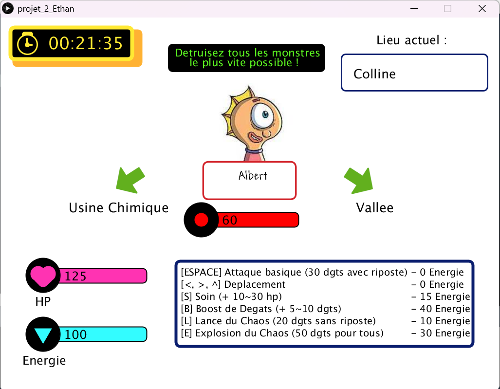
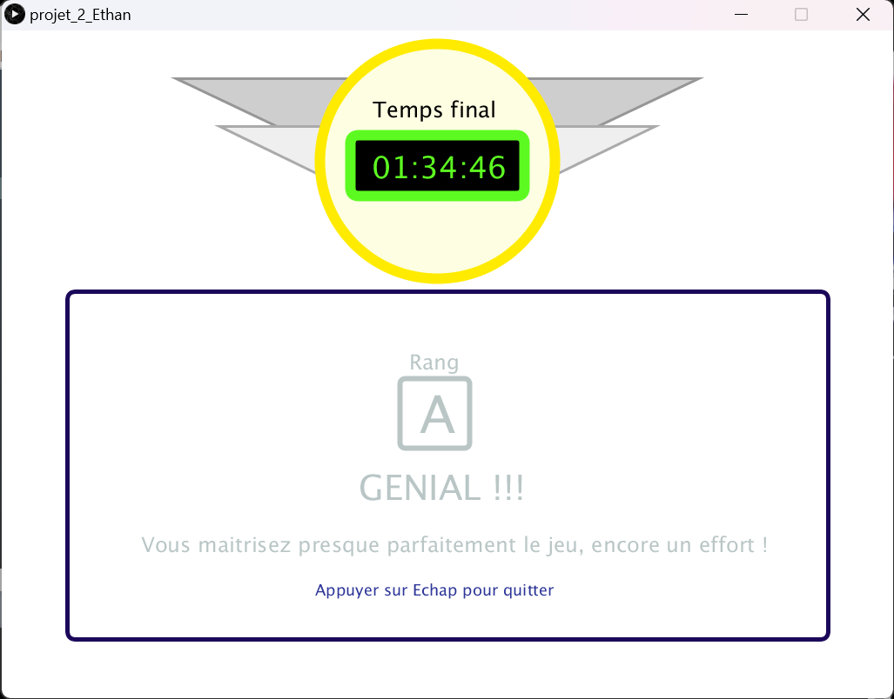

# ⚔️ 🌲 ⏲️ RushMonsters

Jeu de style RPG mêlant stratégie, prise de décisions rapide et gestion du temps et des ressources.  
Réalisé en 2025.

## 🔧 Installation
- Installer Processing ; la version 3 a été utilisée pour ce projet et fonctionne sans problèmes. Des versions modernes peuvent certainement être utilisée pour faire fonctionner le jeu.
- Aller dans le dossier principal 'projet2_Ethan' et ouvrir le fichier 'projet2_Ethan' présent à l'intérieur.
- Une fois le fichier ouvert, cliquer sur la flèche en haut à gauche pour lancer une partie.

## 🛠️ Technologies utilisées
- Processing 3
- Python

## 🏁 But du jeu
L'objectif est d'éliminer tous les ennemis présents sur la map le plus vite possible en utilisant les différentes capacités mises à disposition. Plus vite vous finissez le jeu, meilleur est votre rang à la fin.

## Mécaniques et fonctionnement

### 🌲 Structure d'arbre binaire
La map du jeu suit celle d'un arbre binaire : à chaque noeud, il est possible d'accéder aux deux fils de celui-ci, jusquà arriver aux feuilles de l'arbre.
Le joueur commence la partie à la racine de l'arbre et peut explorer les différentes zones du jeu en descendant et remontant les différents noeuds de l'arbre.

Des flèches indiquent visuellement si le joueur peut encore se déplacer dans l'arborescence.

### ⚔️ Combats
Lorsqu'on choisit d'attaquer un ennemi, l'ennemi et le joueur attaquent en même temps !

#### Ressources
Le joueur possède deux attributs : une barre d'HP et une barre d'Energie.
- ♥️ La barre d'HP indique le nombre de dégâts que le joueur peut encaisser avant de faire un Game Over.
- 🔋 La barre d'Energie représente ce qui permet au joueur d'utiliser des capacités spéciales

#### Attaquer
Le joueur peut attaquer les monstres de 2 manières différentes :
- Avec une attaque simple qui inflige des dégâts à l'ennemi, mais l'ennemi riposte
- Avec une capacité spéciale (voire les explications ci-dessous)
  
En-dessous de sa barre d'énergie, toutes les capacités spéciales du joueur sont spécifiées, ainsi que leurs effets, la touche à appuyé pour l'activer et leur coût en énergie.  
Généralement, plus une capacité est puissante, plus elle coûte de l'énergie.

#### Butin de fin de combat
Si le joueur parvient à terrasser un ennemi, 3 choses peuvent arriver : 
- Gain d'une quantité aléatoire d'HP
- Gain d'une quantité aléatoire d'Energie
- ...rien du tout 😢

À vous de gérer vos ressources pour ressortir de ces combats sains et saufs !
  
### ⏲️ Timer et Rang

Le but ultime du jeu est de le finir le plus vite possible. Comme les monstres et leur placement ne sont pas générés aléatoirement, il est possible d'apprendre les chemins les plus efficaces pour finir le jeu rapidement.

Plus vous êtes rapides, plus vous aurez un meilleur rang, allant de D à S pour les experts !

## 👥 Contributeurs
- [EthanAymeric](https://github.com/EthanAymeric)
- [mchargui212](https://github.com/mchargui212)
